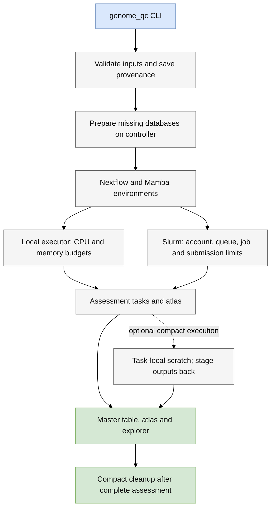
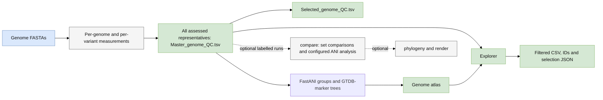

# Workflow and architecture

The complete command starts from genomes and ends with a genome atlas and
explorer. Quality acceptance is applied after assessment, so low-quality genomes
remain available for comparison. A missing measurement is distinguished from a
measurement that fails a user-defined threshold.

```{image} assets/workflow-detailed.svg
:alt: Detailed nodal workflow showing preprocessing, CheckM, taxonomy, rRNA checks, representative selection, parallel tRNA and GUNC assessment, integration, atlas and explorer.
:align: center
:class: workflow-detailed
```

[Full-size SVG](assets/workflow-detailed.svg) · [PDF](assets/workflow-detailed.pdf) ·
[Brief overview](index.md)

The figures use the current MP/ASPIRE nodal style: blue circles are inputs,
white diamonds are processes, and green circles are outputs. Labels sit beside
nodes; smaller parenthesized text names software or ranking criteria. Black dots
mark joins and splits. There is no separate numbered module spine.

The connected flow follows genome assessment through the final products. tRNA
prediction and GUNC independently assess the same representative and join at
integration. Final selection branches from the complete master table; it does
not gate the atlas. With no acceptance criteria, selection is unrestricted.
The explorer indexes the complete results and the selected subset. Reference
inputs are grouped at the start; the database guide details which tool uses each.

## What happens to each genome

1. **Preprocess.** Validate identifiers, record input checksums, decompress FASTAs,
   create requested contig-length variants, and obtain SeqKit assembly statistics.
   All contigs are kept unless `--filter_size` is supplied. Unusable inputs remain
   accounted for in the inventory.
2. **Measure quality.** Run CheckM `lineage_wf` on nonempty variants. Combine
   completeness, contamination, strain heterogeneity and assembly statistics into
   the [Qscore](interpretation.md). No quality threshold removes a genome here.
3. **Classify.** GTDB-Tk 2.8.0 uses GTDB R232 with `--place_species`, retaining
   marker alignments and placement even for genomes assigned by the initial ANI
   screen. Its classification supplies taxonomic context and RNA model selection.
4. **Check rRNAs.** barrnap predicts rRNA genes; BLAST+ self-comparisons and the
   consistency helper summarize agreement among the recovered rRNAs. These checks
   contribute evidence rather than an automatic early exclusion.
5. **Choose one variant and finish assessment.** Within each original input genome,
   rank variants by Qscore, N50 and length. tRNAscan-SE and GUNC then assess the
   representative independently. This step does not collapse distinct input genomes.
6. **Integrate and select.** Join measurements and tool outcomes into the complete
   master table. Apply any explicitly requested final acceptance bounds and write
   the selected subset separately. Defaults are unrestricted.
7. **Build the atlas.** Annotate quality metrics and generate summary figures from
   all assessed representatives. Labelled-set statistical comparisons require comparison settings. Cohort ANI
   grouping and marker trees run by default even for an unlabelled genome directory.
8. **Explore.** Index tables and atlas figures into the explorer. Search, filter,
   follow genome subsets across linked tables, and export CSVs and documented
   selection records. Table filters do not recompute the atlas.

See [software citations](citations.md), [selection semantics](selection.md) and
[failure recovery](recovery.md) for interpretation and operational details.

## Local and Slurm architecture



Database preparation and dependency solving occur on the controller. Scientific
tasks use the chosen executor. In compact mode, task scratch is temporary while
shared work supports incomplete-run recovery. Compact cleanup waits for the
cohort, atlas and report and is deferred when assessment failures remain.

## Data flow and optional analyses



The full workflow does not run MetaPathways annotation or pathway inference.
Labelled comparisons and selected-set phylogenies remain available as separate
commands. The complete run includes cohort ANI and domain-specific marker
trees without requiring study labels. See [ANI and phylogeny](phylogeny.md).
